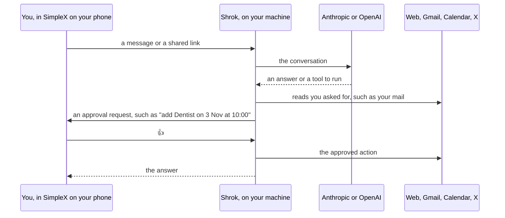

# Shrok

Shrok is a personal assistant that runs on your own computer or server, and you talk to it through [SimpleX Chat](https://simplex.chat) on your phone. It answers questions, remembers what you tell it, saves the links and files you share, runs reminders on a schedule, and reads the web for you. With Google or X set up, it can also read your mail and calendar, draft replies, and read posts.

> [!WARNING]
> Shrok is in alpha. It is a personal project that one person builds in their spare time, so expect rough edges and changes that break things between versions. Keep a backup of your data folder, as [docs/backup.md](docs/backup.md) describes. There is no support promise, but you can report bugs in the [issue tracker](https://github.com/bjoernaagaard/shrok/issues) and security problems as [SECURITY.md](SECURITY.md) describes.

## How it works

Shrok keeps your chats, memory and saved items in its data folder on your machine. It sends each conversation to the model provider whose API key you set, and it asks you on your phone before it does anything outside your machine.

| What Shrok does | Does it wait for your 👍? |
| --- | --- |
| Reads a page you sent, your mail or your calendar | No |
| Opens a web address that neither you nor a tool gave it | Yes |
| Adds a calendar event, sets a reminder or saves a flow | Yes, for the exact event, time or script |
| Clicks a button that books, buys, pays, signs up or sends | Yes |
| Reads a post on X, which costs X credits | Yes |
| Sends an email, or posts, replies or likes on X | It can't. It saves an email as a Gmail draft for you to send. |

## What you need

- An API key from [Anthropic](https://console.anthropic.com) or [OpenAI](https://platform.openai.com).
- SimpleX Chat on your phone.
- A Mac with Apple silicon or Intel, or Linux on amd64 or arm64. On Linux, Shrok's sandbox needs user namespaces.

## Install

| Where | How | Guide |
| --- | --- | --- |
| Mac | `brew install bjoernaagaard/shrok/shrok` | [docs/setup.md](docs/setup.md#homebrew) |
| Debian or Ubuntu | the `.deb` from the [releases page](https://github.com/bjoernaagaard/shrok/releases) | [docs/setup.md](docs/setup.md#debian-and-ubuntu) |
| Docker | `ghcr.io/bjoernaagaard/shrok` with `packaging/oci/compose.yaml` | [docs/setup.md](docs/setup.md#docker) |
| Any Linux or Mac | the portable archive from the [releases page](https://github.com/bjoernaagaard/shrok/releases) | [docs/setup.md](docs/setup.md#portable-archive) |

Then pair your phone with the command for your install in [docs/pairing.md](docs/pairing.md).

## Settings

Shrok reads its settings from the environment.

| Setting | What it does | Default |
| --- | --- | --- |
| `ANTHROPIC_API_KEY` or `OPENAI_API_KEY` | The model key. Shrok needs one of them. |  |
| `SHROK_TIME_ZONE` | The zone for schedules and calendar times, such as `Europe/Copenhagen` | the system's zone |
| `SHROK_LOCALE` | The language for dates, such as `en-GB` | `LC_ALL`, `LC_TIME` or `LANG`, then macOS's region |
| `SHROK_DATA_DIR` | Where Shrok keeps chats, memory and its SimpleX keys | `/var/lib/shrok` on Linux, `~/Library/Application Support/Shrok` on macOS |
| `SHROK_MODEL`, `SHROK_SMALL_MODEL`, `SHROK_CLASSIFIER` | The models, as `provider/model` | chosen by which key is set |
| `SHROK_MCP_CONFIG` | An `mcp.json` listing MCP servers | `mcp.json` in the data folder |
| `SHROK_BROWSER` | A Chromium binary to use instead of the bundled one |  |

Any key can also come from a file. Set `ANTHROPIC_API_KEY_FILE` to the file's path, or use a systemd credential with the same name.

## Guides

- [Setup](docs/setup.md)
- [Pairing your phone](docs/pairing.md)
- [Backing up](docs/backup.md)
- [Upgrading](docs/upgrade.md)
- [Google: Gmail and Calendar](docs/google.md)
- [X posts](docs/x.md)

## License

Shrok is free software under the [GNU Affero General Public License 3.0](LICENSE).
