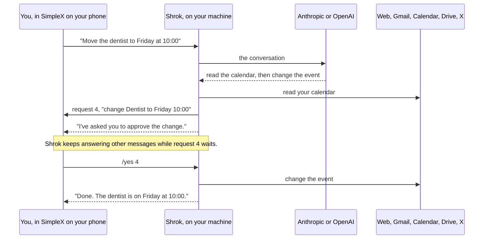

# Shrok

Shrok is a personal assistant that runs on your own computer or server, and you talk to it through [SimpleX Chat](https://simplex.chat) on your phone. It answers questions, remembers what you tell it, saves the links and files you share, and runs reminders and tasks on a schedule. With Google or X set up, it can also work with your mail, calendar, Drive and posts on X.

> [!WARNING]
> Shrok is in alpha. One person builds it in their spare time, so expect rough edges and changes that break things between versions. Keep a backup of your data folder, as [docs/backup.md](docs/backup.md) describes. There is no support promise, but you can report bugs in the [issue tracker](https://github.com/bjoernaagaard/shrok/issues), and you can report security problems as [SECURITY.md](SECURITY.md) describes.

## How a message is answered

Shrok keeps your chats, memory and saved items on your machine, and it sends each conversation to the model provider whose key you set. When a task needs an action outside your machine, such as sending an email, Shrok asks you on your phone first.



## What Shrok asks you about

Shrok reads and keeps notes on its own, and it asks before it acts for you outside your machine.

| What Shrok does | Does it ask you first? |
| --- | --- |
| Reads a page you sent, your mail, your calendar or your Drive | No |
| Sets a reminder or a task for later, archives or labels mail, or keeps a list | No, and it tells you what it did |
| Opens a web address that neither you nor a page gave it | Yes |
| Adds, changes or deletes a calendar event, or saves a flow | Yes, for the exact event or script |
| Clicks a button that books, buys, pays, signs up or sends | Yes |
| Reads a post on X, which costs X credits | Yes |
| Sends an email | Yes, for the exact email and the Google account it sends from |
| Runs a `gws` or `xurl` command, such as a post on X | Yes, for the exact command |

A request stays open until you answer it. You can answer in any of the ways below, and Shrok then tells you how the action went.

```text
/yes 4      do request 4 once
/no 4       don't do it
/always 4   do it, and allow the same kind of action from now on
            (an email only to the same recipients, a command only exactly the same)
/grants     list what you allowed with /always
/revoke 2   take back the second item on that list
```

You can also react with 👍 or 👎 on a request, or quote it in a reply with "yes" or "no".

## What you need

- An API key from [Anthropic](https://console.anthropic.com) or [OpenAI](https://platform.openai.com).
- SimpleX Chat on your phone.
- A Mac with Apple silicon or Intel, or Linux on amd64 or arm64. On Linux, Shrok's sandbox needs user namespaces.

## Install

| Where | How | Guide |
| --- | --- | --- |
| Mac | `brew tap bjoernaagaard/shrok`, `brew trust bjoernaagaard/shrok`, then `brew install shrok` | [docs/setup.md](docs/setup.md#homebrew) |
| Debian or Ubuntu | the `.deb` from the [releases page](https://github.com/bjoernaagaard/shrok/releases) | [docs/setup.md](docs/setup.md#debian-and-ubuntu) |
| Docker | `ghcr.io/bjoernaagaard/shrok` with `packaging/oci/compose.yaml` | [docs/setup.md](docs/setup.md#docker) |
| Any Linux or Mac | the portable archive from the [releases page](https://github.com/bjoernaagaard/shrok/releases) | [docs/setup.md](docs/setup.md#portable-archive) |

After you install Shrok, pair your phone with the command for your install in [docs/pairing.md](docs/pairing.md).

## Where Shrok keeps your data

Everything Shrok knows is in one data folder, so a copy of the folder is a full backup. Shrok's tools can open only the workspace inside it.

```text
~/Library/Application Support/Shrok/    (on Linux, /var/lib/shrok)
├── secrets.env      your keys and settings, if you keep them here
├── shrok.sqlite     the conversation
├── memory.sqlite    what Shrok remembers of it
├── approvals.sqlite requests and what you allowed with /always
├── simplex/         the SimpleX keys that make Shrok your contact
└── workspace/       the only folder Shrok's tools can open
    ├── items/       links, files and notes you shared, as Markdown
    ├── lists/       lists you keep, such as shopping
    ├── flows/       saved scripts for tasks you repeat
    └── skills/      your own how-to notes for Shrok
```

## Settings

Shrok reads each setting from the environment first, and then from `secrets.env` in the data folder.

| Setting | What it does | Default |
| --- | --- | --- |
| `ANTHROPIC_API_KEY` or `OPENAI_API_KEY` | The model key. Shrok needs one of them. |  |
| `SHROK_TIME_ZONE` | The zone for schedules and calendar times, such as `Europe/Copenhagen` | the system's zone |
| `SHROK_LOCALE` | The language for dates, such as `en-GB` | `LC_ALL`, `LC_TIME` or `LANG`, then the macOS region |
| `SHROK_DATA_DIR` | Where Shrok keeps its data | `/var/lib/shrok` on Linux, `~/Library/Application Support/Shrok` on macOS |
| `SHROK_MODEL`, `SHROK_SMALL_MODEL`, `SHROK_CLASSIFIER` | The models, written as `provider/model` | chosen by which key is set |
| `SHROK_MCP_CONFIG` | An `mcp.json` file that lists MCP servers | `mcp.json` in the data folder |
| `SHROK_BROWSER` | A Chromium binary to use instead of the bundled one |  |
| `SHROK_LINKS_FILE` | A text file of links, one per line. Shrok saves each new link and tells you. |  |

You can keep your keys in whatever way you like, because Shrok only needs them in its environment when it starts. Shrok looks for each key in the order below and uses the first one it finds.

```text
for each key, such as ANTHROPIC_API_KEY
  1. the environment, which a secret manager such as secretspec, 1Password's op or bas can fill
  2. the file that ANTHROPIC_API_KEY_FILE names, as with Docker secrets
  3. a systemd credential with the same name
  4. a line in secrets.env, which must be readable only by Shrok's user (chmod 600)
```

## Guides

- [Setup](docs/setup.md)
- [Pairing your phone](docs/pairing.md)
- [Backing up](docs/backup.md)
- [Upgrading](docs/upgrade.md)
- [Google: Gmail, Calendar and Drive](docs/google.md)
- [X posts](docs/x.md)

## License

Shrok is free software under the [GNU Affero General Public License 3.0](LICENSE).
